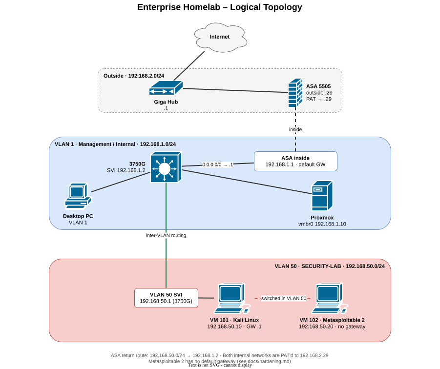
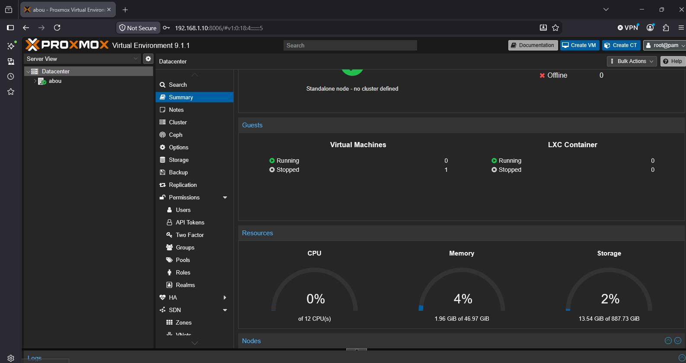

# Enterprise Cybersecurity Homelab

An enterprise-style cybersecurity homelab built with Cisco networking equipment, a Dell PowerEdge server, Proxmox VE, Kali Linux and intentionally vulnerable systems.

The lab simulates a small enterprise network where I practice networking, firewalling, virtualization, offensive security and defensive security in an isolated environment. This repository documents its design, deployment, configuration, troubleshooting and security testing.

**Focus areas:** network infrastructure · VLAN segmentation · Layer 2/3 switching · Cisco ASA administration · NAT/PAT · virtualization · Linux administration · reconnaissance and enumeration · vulnerability assessment · penetration testing · security documentation

---

## Table of contents

- [Lab architecture](#lab-architecture)
- [Addressing plan](#addressing-plan)
- [Hardware](#hardware)
- [Component summary](#component-summary)
- [Penetration testing](#penetration-testing)
- [Labs](#labs)
- [Troubleshooting](#troubleshooting)
- [Skills demonstrated](#skills-demonstrated)
- [Repository structure](#repository-structure)
- [Project status](#project-status)
- [Security disclaimer](#security-disclaimer)

---

## Lab architecture

<p align="center">
  
</p>

> The first version of the physical topology (before VLAN 50 was built) is kept for reference: [`screenshots/initial-physical-topology.png`](screenshots/initial-physical-topology.png).

Physical topology, traffic paths and details: [docs/topology.md](docs/topology.md)

> Diagrams are made with [draw.io](https://www.drawio.com/). The `.drawio.svg` files in [`diagrams/`](diagrams/) embed the editable diagram, so they can be opened and edited directly in draw.io.

---

## Addressing plan

### VLAN 1 – Management / internal

| Component        | Address           |
| ---------------- | ----------------- |
| Network          | `192.168.1.0/24`  |
| Cisco ASA inside | `192.168.1.1/24`  |
| Cisco 3750G SVI  | `192.168.1.2/24`  |
| Proxmox (vmbr0)  | `192.168.1.10/24` |

The ASA is the default gateway for VLAN 1 and the Internet edge firewall.

### VLAN 50 – SECURITY-LAB

| Component        | Address            |
| ---------------- | ------------------ |
| Network          | `192.168.50.0/24`  |
| VLAN 50 SVI      | `192.168.50.1/24`  |
| Kali Linux       | `192.168.50.10/24` |
| Metasploitable 2 | `192.168.50.20/24` |

The 3750G hosts the VLAN 50 SVI and routes between VLAN 50 and VLAN 1. Metasploitable 2 has no default gateway so its vulnerable services cannot reach the Internet directly (see [hardening notes](docs/hardening.md)).

### Outside

| Component         | Address                  |
| ----------------- | ------------------------ |
| Bell Giga Hub LAN | `192.168.2.1/24`         |
| ASA outside       | `192.168.2.29/24` (DHCP) |

---

## Hardware

| Role            | Device                                                       |
| --------------- | ------------------------------------------------------------ |
| Hypervisor      | Dell PowerEdge R320 – 12 vCPU, ~47 GiB RAM, 2 × 1 TB HDD in RAID 1 |
| Firewall        | Cisco ASA 5505                                               |
| L3 switch       | Cisco WS-C3750G-24TS-1U – IOS 15.0(2)SE7, IP Services        |
| ISP gateway     | Bell Giga Hub                                                |
| Management      | Desktop PC                                                   |

---

## Component summary

| Component | What it does | Details |
| --------- | ------------ | ------- |
| **Proxmox VE 9.1** | Hosts the lab VMs; VLAN-aware bridge `vmbr0` carries management and tagged VLAN 50 traffic | [docs/infrastructure/proxmox.md](docs/infrastructure/proxmox.md) |
| **Cisco 3750G** | VLANs, 802.1Q trunk to Proxmox, inter-VLAN routing, default route to the ASA | [docs/infrastructure/cisco-3750g.md](docs/infrastructure/cisco-3750g.md) |
| **Cisco ASA 5505** | Internet edge, inside/outside security levels, PAT for internal networks | [docs/infrastructure/cisco-asa.md](docs/infrastructure/cisco-asa.md) |
| **Kali Linux** (VM 101) | Attacker workstation: Nmap, Metasploit, SearchSploit | [docs/security-lab/virtual-machines.md](docs/security-lab/virtual-machines.md) |
| **Metasploitable 2** (VM 102) | Intentionally vulnerable target, no default gateway | [docs/security-lab/virtual-machines.md](docs/security-lab/virtual-machines.md) |

<p align="center">
  
</p>

---

## Penetration testing

Every exercise follows the same methodology:

```text
Reconnaissance → Enumeration → Vulnerability research → Exploitation → Post-exploitation enumeration → Documentation
```

| # | Exercise | Target | Result |
| - | -------- | ------ | ------ |
| 01 | [vsftpd 2.3.4 backdoor](docs/penetration-testing/01-vsftpd-2.3.4/README.md) | Metasploitable 2 (`192.168.50.20`) | Root-level command execution |

---

## Labs

Smaller, focused labs built on the main environment, each with configuration, verification and a break/fix exercise. Full index: [labs/](labs/README.md)

| # | Lab | Topics |
| - | --- | ------ |
| 01 | [VLANs and 802.1Q trunking](labs/01-vlan-trunking/README.md) | VLAN 20, SVIs, trunk allowed lists, VLAN-tagged VMs |
| 02 | [NAT, PAT and port forwarding](labs/02-nat-port-forwarding/README.md) | ASA object NAT, static PAT, outside ACL, `packet-tracer` |
| 03 | [DHCP server and relay](labs/03-dhcp-server-relay/README.md) | DHCP pools, DORA, `ip helper-address` |
| 04 | [ACLs and port security](labs/04-acl-port-security/README.md) | VLAN 50 isolation, VTY access-class, err-disable |
| 05 | [IPv6 dual stack](labs/05-ipv6-dual-stack/README.md) | SDM template, IPv6 SVIs, SLAAC |

---

## Troubleshooting

### Break/fix scenarios

Faults introduced on purpose and diagnosed like support tickets: symptoms → hypotheses → evidence → root cause → fix → verification. Full index: [troubleshooting/](troubleshooting/README.md)

| ID | Scenario | Layer |
| -- | -------- | ----- |
| [TS-01](troubleshooting/TS-01-trunk-missing-vlan.md) | VLAN missing from the trunk allowed list | L2 |
| [TS-02](troubleshooting/TS-02-asa-missing-return-route.md) | ASA missing the return route to VLAN 50 | L3 |
| [TS-03](troubleshooting/TS-03-wrong-default-gateway.md) | Wrong default gateway on a host | L3 |
| [TS-04](troubleshooting/TS-04-vlan-deleted-svi-down.md) | VLAN deleted, SVI up/down | L2/L3 |
| [TS-05](troubleshooting/TS-05-asa-nat-missing.md) | NAT rule missing for a subnet | NAT |
| [TS-06](troubleshooting/TS-06-proxmox-vm-missing-vlan-tag.md) | Proxmox VM missing its VLAN tag | L2 (virtual) |

### Issues hit while building the lab

The lab was built and debugged one hop at a time, bottom-up through the OSI model:

```text
L1 Physical → L2 Switching / VLANs → L3 Addressing / Routing → L4 TCP/UDP → L7 Services
```

Key lessons: a Proxmox management outage caused by an unplugged cable, a desktop initially outside the intended firewall/switch path, and understanding which ASA interface (inside vs outside) internal hosts should use as their gateway.

Full write-up: [docs/troubleshooting.md](docs/troubleshooting.md)

---

## Skills demonstrated

| Area | Skills |
| ---- | ------ |
| **Networking** | Cisco IOS, VLANs, 802.1Q trunking, L2/L3 switching, inter-VLAN routing, static and default routing, IP addressing, troubleshooting |
| **Firewall** | Cisco ASA 5505, inside/outside interfaces, security levels, routing, NAT/PAT, `packet-tracer`, Internet edge design |
| **Virtualization** | Proxmox VE, VM deployment, VLAN-aware Linux bridges, virtual networking, virtual disk management |
| **Linux** | Kali Linux, Linux networking and IP configuration, command-line administration |
| **Cybersecurity** | Reconnaissance, Nmap, service enumeration, SearchSploit, Metasploit, Meterpreter, vulnerability validation, post-exploitation enumeration, lab isolation |

---

## Repository structure

```text
Enterprise-homelab/
├── README.md
├── diagrams/                     # draw.io diagrams (editable .drawio.svg)
│   ├── physical-topology.drawio.svg
│   └── logical-topology.drawio.svg
├── labs/                         # Smaller focused labs (01–05)
├── troubleshooting/              # Break/fix scenarios (TS-01–06) + template
├── configs/                      # Sanitized device configurations
│   └── README.md
├── docs/
│   ├── topology.md               # Physical and logical topology
│   ├── troubleshooting.md
│   ├── hardening.md              # Isolation and planned hardening
│   ├── infrastructure/
│   │   ├── proxmox.md
│   │   ├── cisco-3750g.md
│   │   └── cisco-asa.md
│   ├── security-lab/
│   │   └── virtual-machines.md
│   └── penetration-testing/
│       └── 01-vsftpd-2.3.4/
│           └── README.md
└── screenshots/
```

---

## Project status

### Completed

- [x] Dell PowerEdge R320 and Proxmox VE deployed
- [x] Proxmox management networking configured
- [x] Cisco ASA configured (interfaces, routing, NAT/PAT)
- [x] Cisco 3750G configured (VLAN 50, inter-VLAN routing, 802.1Q trunk)
- [x] Internet connectivity validated
- [x] Kali Linux and Metasploitable 2 deployed in VLAN 50
- [x] Exercise 01 – vsftpd 2.3.4: recon, enumeration, exploitation, root access, post-exploitation

### In progress

- [ ] Publish sanitized device configurations in [`configs/`](configs/README.md)
- [ ] Restrict VLAN 50 with ACLs ([hardening plan](docs/hardening.md))
- [ ] Labs 01–05 ([labs/](labs/README.md))
- [ ] Break/fix scenarios TS-01–06 ([troubleshooting/](troubleshooting/README.md))
- [ ] Expand penetration-testing exercises
- [ ] Build additional vulnerable targets
- [ ] Develop defensive security exercises
- [ ] Create custom Python security tools

### Future

- [ ] Dedicated management VLAN (move management off VLAN 1)
- [ ] Windows Server and Active Directory
- [ ] Enterprise DNS/DHCP
- [ ] Detection and monitoring (logging, IDS)
- [ ] Security automation

---

## Security disclaimer

All penetration-testing activities documented here are performed against systems I own or intentionally vulnerable systems inside my isolated homelab. The techniques are documented for authorized security testing, education and skill development only.

---

## Project goal

Build a realistic enterprise-style environment to continuously practice **networking + systems administration + virtualization + offensive security + defensive security + security automation**. The lab will keep evolving as I add technologies, systems and scenarios.
