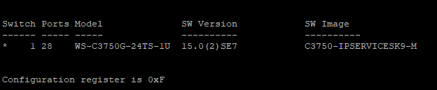

# Cisco 3750G Layer 3 switch

[← Back to README](../../README.md)

| Item | Value |
| ---- | ----- |
| Model | WS-C3750G-24TS-1U |
| IOS | 15.0(2)SE7 – `C3750-IPSERVICESK9-M` |



## Role

- VLAN segmentation (VLAN 1, VLAN 50)
- 802.1Q trunk to Proxmox
- Inter-VLAN routing (SVIs)
- Default route toward the ASA

## VLANs

| VLAN | Name | Network | SVI | Gateway for hosts |
| ---- | ---- | ------- | --- | ----------------- |
| 1 | default (management) | `192.168.1.0/24` | `192.168.1.2` | `192.168.1.1` (ASA) |
| 50 | SECURITY-LAB | `192.168.50.0/24` | `192.168.50.1` | `192.168.50.1` |

## Reference configuration

```text
ip routing
!
vlan 50
 name SECURITY-LAB
!
interface GigabitEthernet1/0/24
 description TRUNK-TO-PROXMOX
 switchport trunk encapsulation dot1q
 switchport mode trunk
 switchport trunk allowed vlan 1,50
!
interface Vlan1
 ip address 192.168.1.2 255.255.255.0
!
interface Vlan50
 description SECURITY-LAB
 ip address 192.168.50.1 255.255.255.0
!
ip route 0.0.0.0 0.0.0.0 192.168.1.1
```

> Replace with the sanitized `show running-config` when publishing [`configs/`](../../configs/README.md).

## Verification

```text
show vlan brief
show interfaces trunk
show ip interface brief
show ip route
```
