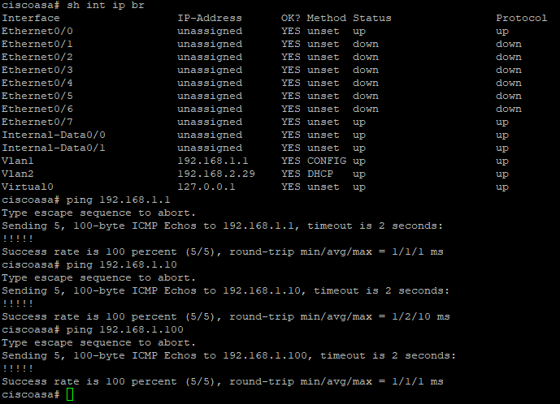

# Cisco ASA 5505

[← Back to README](../../README.md)

The ASA is the Internet edge firewall and the default gateway for VLAN 1.

## Interfaces

| Name | ASA interface | IP | Security level | Notes |
| ---- | ------------- | -- | -------------- | ----- |
| inside | Vlan1 | `192.168.1.1/24` | 100 | Static |
| outside | Vlan2 | `192.168.2.29/24` | 0 | DHCP from Bell Giga Hub (`192.168.2.1`) |



## Routing

| Destination | Next hop | Why |
| ----------- | -------- | --- |
| `0.0.0.0/0` | `192.168.2.1` (outside) | Internet, learned via DHCP |
| `192.168.50.0/24` | `192.168.1.2` (inside) | Return path to VLAN 50 through the 3750G |

The ASA only knows `192.168.1.0/24` directly. Without the static route to `192.168.50.0/24`, replies to VLAN 50 hosts would have nowhere to go.

## NAT / PAT

Both internal networks are translated to the outside interface address:

```text
192.168.1.0/24  ─┐
                 ├─► ASA PAT ─► 192.168.2.29 ─► Internet
192.168.50.0/24 ─┘
```

## Reference configuration

```text
interface Vlan1
 nameif inside
 security-level 100
 ip address 192.168.1.1 255.255.255.0
!
interface Vlan2
 nameif outside
 security-level 0
 ip address dhcp setroute
!
object network INSIDE-NET
 subnet 192.168.1.0 255.255.255.0
 nat (inside,outside) dynamic interface
object network LAB-NET
 subnet 192.168.50.0 255.255.255.0
 nat (inside,outside) dynamic interface
!
route inside 192.168.50.0 255.255.255.0 192.168.1.2
```

> Replace with the sanitized `show running-config` when publishing [`configs/`](../../configs/README.md).

## Validation

Connectivity from VLAN 50 to the Internet was validated with `packet-tracer`:

```text
packet-tracer input inside icmp 192.168.50.10 8 0 8.8.8.8
```

Result: NAT phase **ALLOW**, final action **allow**.
