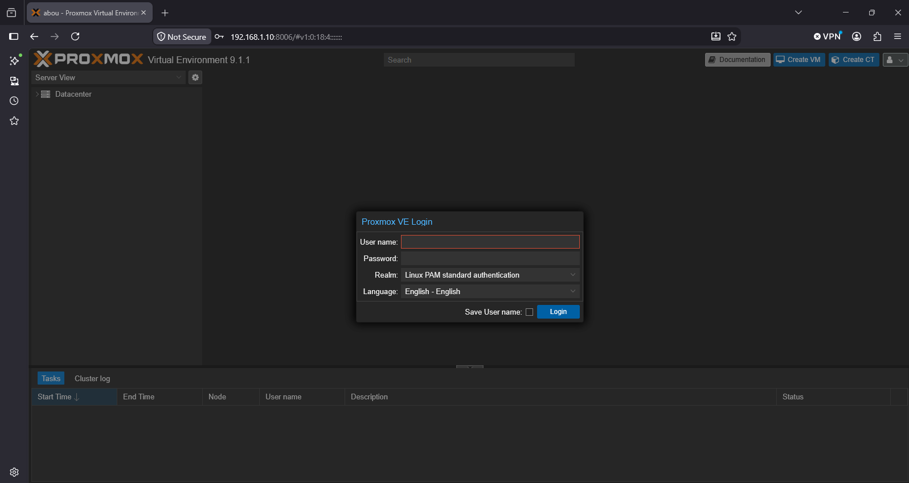
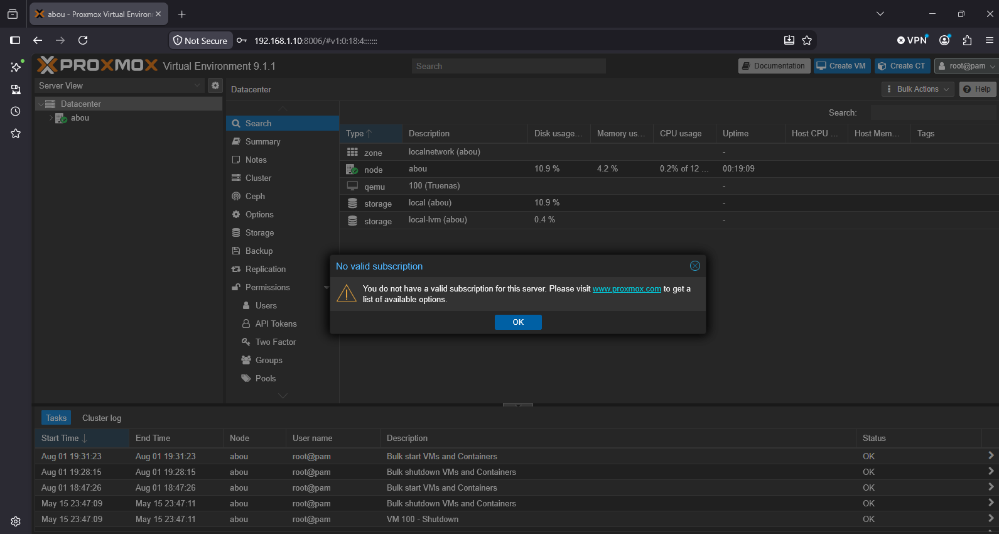
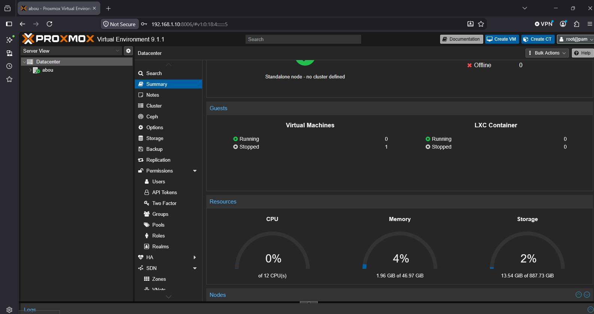

# Proxmox VE

[← Back to README](../../README.md)

## Host

| Item | Value |
| ---- | ----- |
| Hardware | Dell PowerEdge R320 |
| Storage | 2 × 1 TB HDD, RAID 1 |
| Resources | 12 CPUs, ~47 GiB RAM |
| Version | Proxmox VE 9.1.1 (standalone node) |
| Management | `https://192.168.1.10:8006` |



## Networking

| Item | Value |
| ---- | ----- |
| Bridge | `vmbr0` (VLAN-aware) |
| Physical port | `nic0` → Cisco 3750G `Gi1/0/24` (802.1Q trunk) |
| Host IP | `192.168.1.10/24` (VLAN 1, untagged) |
| Gateway | `192.168.1.1` (ASA inside) |

`vmbr0` carries the untagged management network and the tagged VLAN 50 traffic. Each lab VM's network device is set to **VLAN tag 50**.

Reference `/etc/network/interfaces`:

```text
auto lo
iface lo inet loopback

iface nic0 inet manual

auto vmbr0
iface vmbr0 inet static
    address 192.168.1.10/24
    gateway 192.168.1.1
    bridge-ports nic0
    bridge-stp off
    bridge-fd 0
    bridge-vlan-aware yes
    bridge-vids 2-4094
```

> Replace this with the exact file from the host when publishing [`configs/`](../../configs/README.md).

## Virtual machines

| VM ID | System | IP | VLAN | Purpose |
| ----- | ------ | -- | ---- | ------- |
| 101 | Kali Linux | `192.168.50.10` | 50 | Penetration testing |
| 102 | Metasploitable 2 | `192.168.50.20` | 50 | Vulnerable target |



