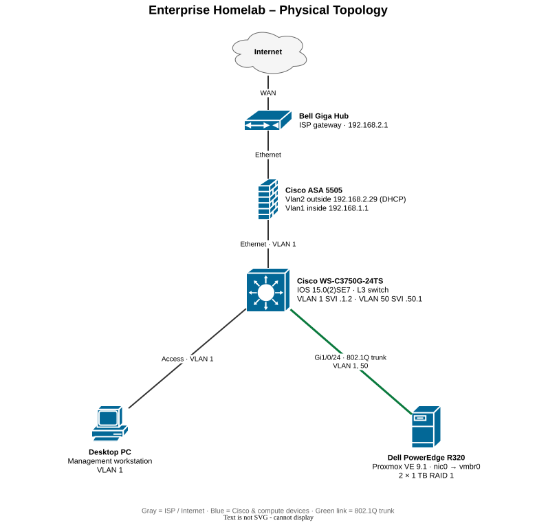
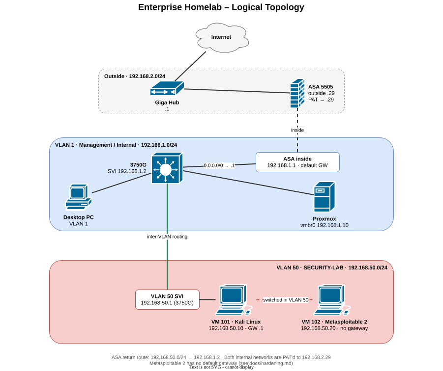
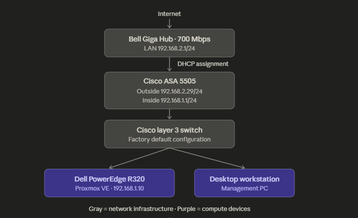

# Topology

[← Back to README](../README.md)

## Physical topology

## Logical topology

## Editing the diagrams

The diagrams are draw.io files saved as `.drawio.svg`: GitHub renders them as images, and draw.io (desktop or [app.diagrams.net](https://app.diagrams.net)) opens them as editable diagrams. Open the file, edit, save – no separate export needed.

## Traffic paths

| Flow | Path |
| ---- | ---- |
| PC → Proxmox | PC → 3750G (VLAN 1) → Proxmox `192.168.1.10` |
| Kali → Metasploitable | Same subnet, switched inside VLAN 50 on `vmbr0` |
| Kali → Internet | Kali → SVI `192.168.50.1` → 3750G default route → ASA `192.168.1.1` → PAT to `192.168.2.29` → Giga Hub |
| Metasploitable → Internet | Blocked by design: no default gateway |

## Initial topology

The original diagram, drawn before VLAN 50 existed, while the switch was still at factory defaults:

