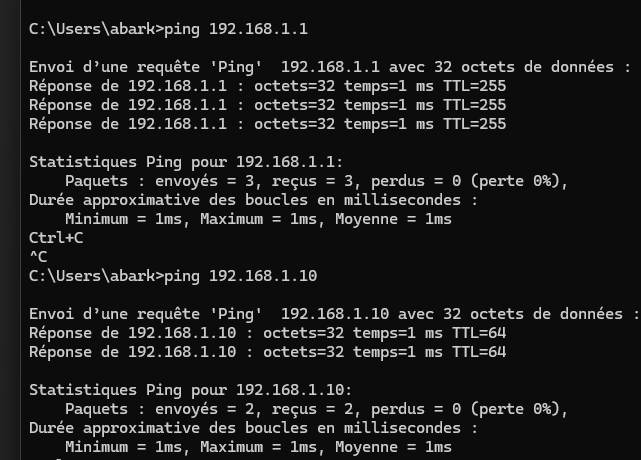
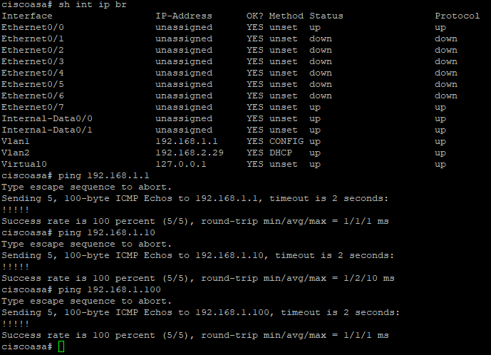

# Troubleshooting

[← Back to README](../README.md)

## Methodology

Instead of changing several settings at once, I tested connectivity one hop at a time, from the bottom of the OSI model up:

```text
L1  Physical connectivity
 ↓
L2  Switching / VLANs
 ↓
L3  IP addressing / routing
 ↓
L4  TCP / UDP connectivity
 ↓
L7  Applications / services
```

## Issues encountered

### 1. Proxmox management unreachable

| | |
| - | - |
| **Symptom** | Could not reach the Proxmox web UI |
| **Cause** | Ethernet cable not physically connected |
| **Fix** | Verify link → connect cable → check interface status → retest |
| **Lesson** | Always confirm Layer 1 first |

### 2. Desktop outside the intended path

| | |
| - | - |
| **Symptom** | Management traffic from the PC did not reach the internal network |
| **Cause** | The PC was not connected through the firewall/switch topology |
| **Fix** | Re-cabled the PC to the 3750G in VLAN 1 |

### 3. ASA inside vs outside

| | |
| - | - |
| **Confusion** | Which ASA address internal hosts should use as their gateway |
| **Answer** | Inside `192.168.1.1` (security level 100) faces the internal network; outside `192.168.2.29` (level 0) faces the Giga Hub and the Internet |

## Validation

| Test | Result |
| ---- | ------ |
| PC → ASA (`192.168.1.1`) | ✅ |
| PC → Proxmox (`192.168.1.10`) | ✅ |
| Proxmox → ASA | ✅ |
| ASA → 3750G | ✅ |
| ASA → VLAN 50 | ✅ |
| Kali → Metasploitable | ✅ |
| Kali → Internet | ✅ |

PC to ASA and Proxmox:



ASA interfaces and pings to the internal network:


